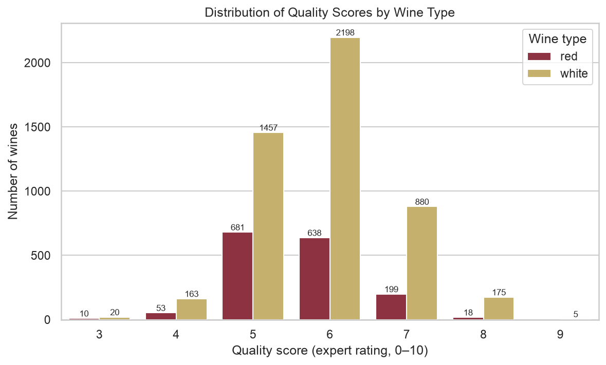
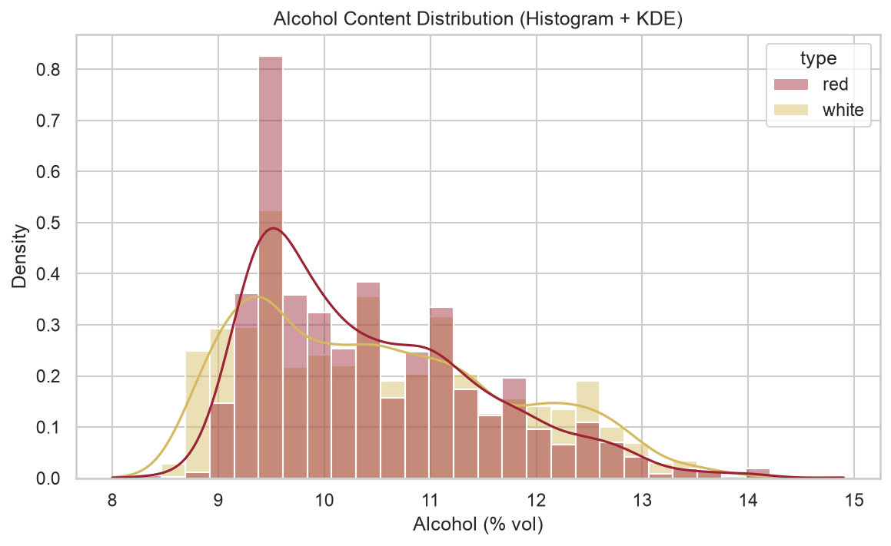
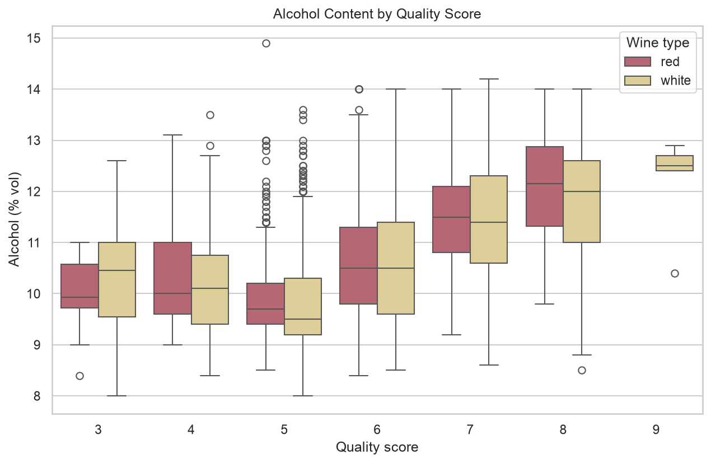
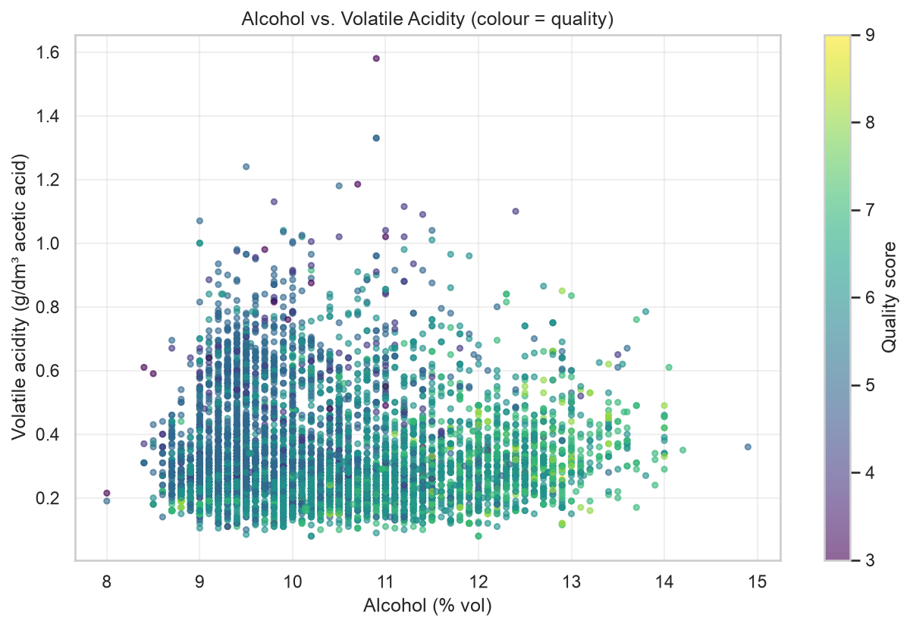
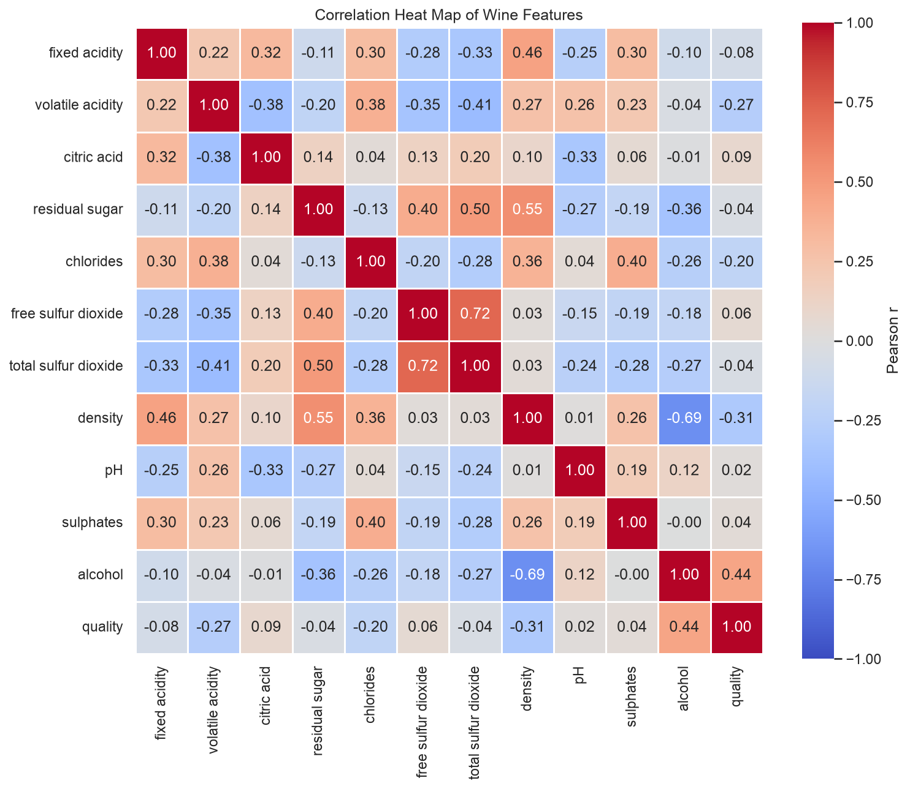
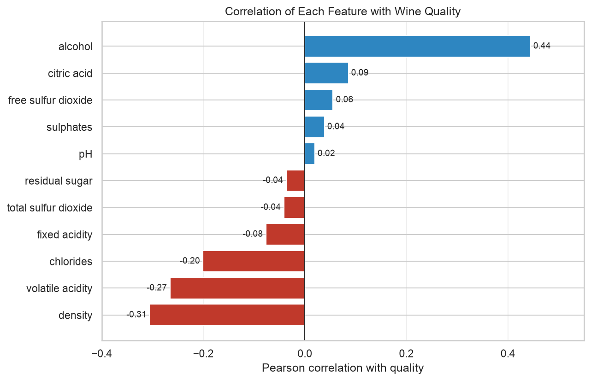
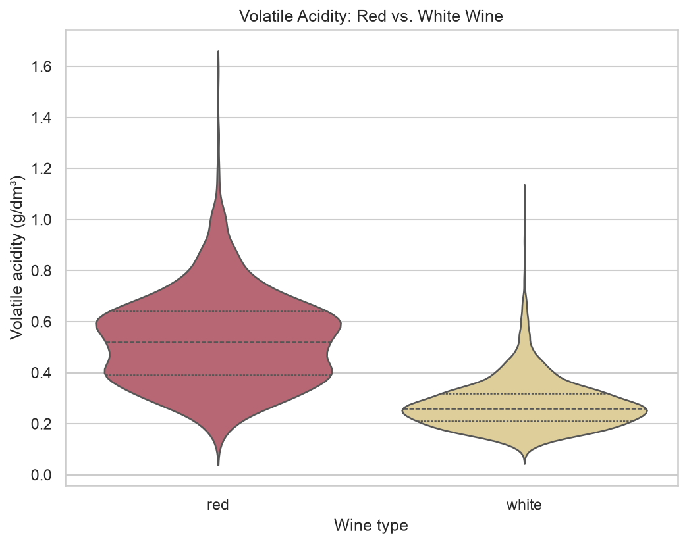
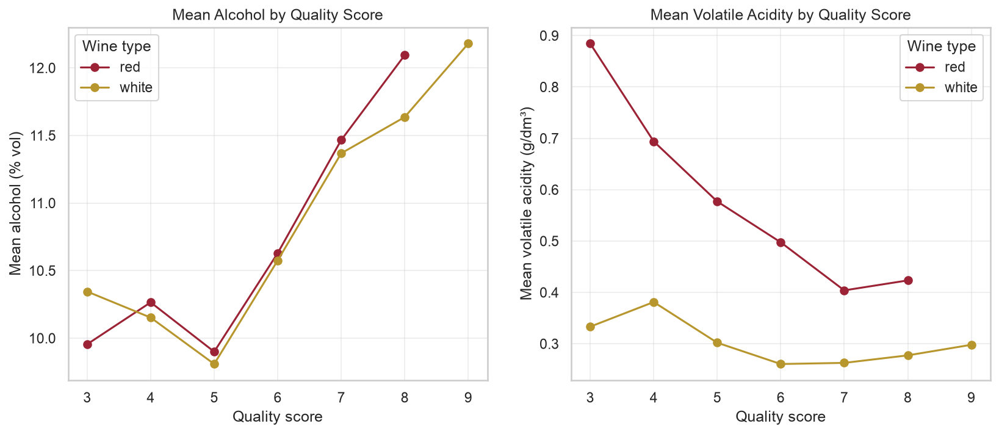
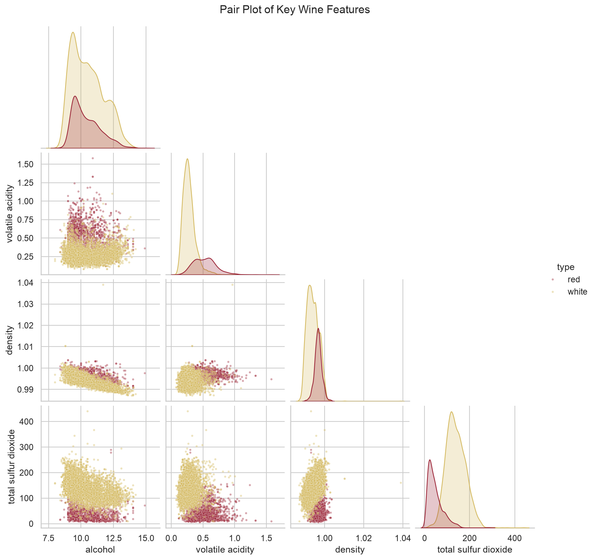
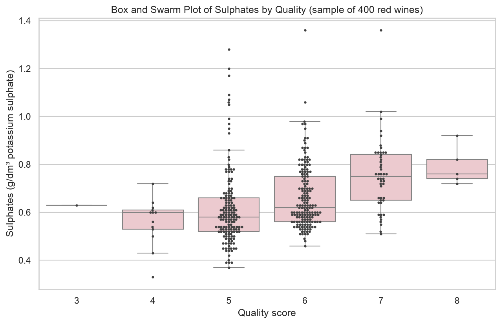

# Lab 8 — Data Visualization using Python (Matplotlib & Seaborn)

Exploratory visualization of the **[Wine Quality dataset](https://archive.ics.uci.edu/dataset/186/wine+quality)** from the UCI Machine Learning Repository
(P. Cortez et al., 2009): 6,497 Portuguese *Vinho Verde* wines (1,599 red, 4,898 white), with 11 physicochemical features and an expert quality score (0–10).

## Repository contents

| Path | Description |
|---|---|
| `Lab8_WineQuality.ipynb` | Main notebook: data loading, exploration and 10 visualizations |
| `Lab8JupyterNotebook.ipynb` | Reference notebook from class (Iris dataset) |
| `data/` | Raw UCI CSV files (`winequality-red.csv`, `winequality-white.csv`) |
| `charts/` | Every chart exported as a PNG |
| `requirements.txt` | Python dependencies |

## Setup & run

```bash
# conda (as in the lab instructions)
conda create --name info5100 python
conda activate info5100
pip install -r requirements.txt

# or a plain venv
python -m venv .venv
.venv\Scripts\activate        # Windows
pip install -r requirements.txt

jupyter notebook Lab8_WineQuality.ipynb
```

## Visualizations

| # | Chart | Library | Type |
|---|---|---|---|
| 1 | Quality score distribution by wine type | Seaborn | Bar / count plot |
| 2 | Alcohol content distribution | Seaborn | Histogram + KDE |
| 3 | Alcohol vs. quality | Seaborn | Box plot |
| 4 | Alcohol vs. volatile acidity, coloured by quality | Matplotlib | Scatter (multivariate) |
| 5 | Correlation of all features | Seaborn | Heat map |
| 6 | Each feature's correlation with quality | Matplotlib | Horizontal bar |
| 7 | Volatile acidity: red vs. white | Seaborn | Violin plot |
| 8 | Mean alcohol & volatile acidity per quality score | Matplotlib | Line plot |
| 9 | Pairwise relationships of key features | Seaborn | Pair plot |
| 10 | Sulphates by quality (red wines) | Seaborn | Box + swarm plot |

### 1. Quality distribution


### 2. Alcohol histogram + KDE


### 3. Alcohol by quality (box plot)


### 4. Alcohol vs. volatile acidity (scatter)


### 5. Correlation heat map


### 6. Feature correlation with quality


### 7. Volatile acidity violin plot


### 8. Mean alcohol & volatile acidity by quality (line plot)


### 9. Pair plot of key features


### 10. Sulphates by quality — box + swarm plot


## Key findings

1. **Quality is imbalanced:** about 77% of wines score 5 or 6.
2. **Alcohol** has the strongest positive correlation with quality (r ≈ 0.44).
3. **Density** (r ≈ −0.31) and **volatile acidity** (r ≈ −0.27) have the strongest negative correlations.
4. **Red and white wines differ chemically:** red wines have much higher volatile acidity.

## Dataset citation

P. Cortez, A. Cerdeira, F. Almeida, T. Matos and J. Reis. *Modeling wine preferences by data mining from physicochemical properties.* Decision Support Systems, 47(4):547–553, 2009.
Licensed under CC BY 4.0 via the UCI Machine Learning Repository.
